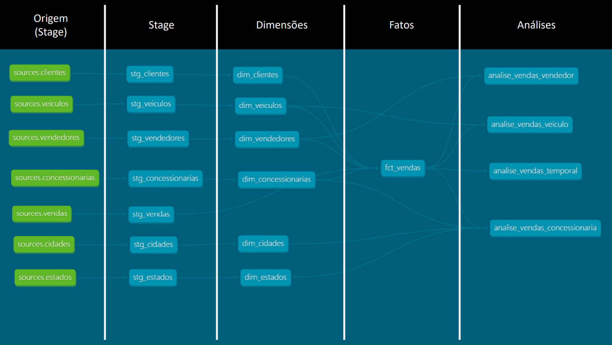
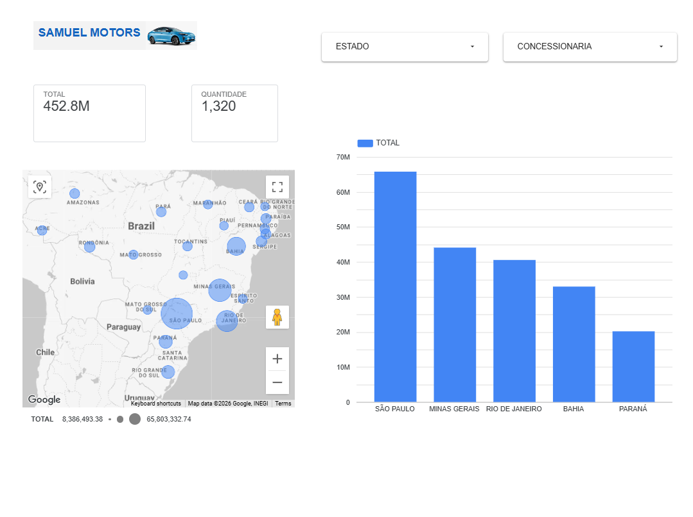

# NovaDrive — Estudo de caso | Engenharia de Dados end-to-end

**Contexto:** projeto prático de bootcamp, baseado em operações comerciais fictícias de concessionárias.  
**Papel:** implementação e estudo da arquitetura de dados, ingestão, transformação, qualidade e visualização.  
**Tecnologias:** Python, PostgreSQL, AWS EC2, Linux, Docker Compose, Apache Airflow, Snowflake, dbt, SQL/Jinja, Git/GitHub e Looker Studio.

## Resumo executivo

O projeto NovaDrive integra registros operacionais de vendas de veículos a um ambiente analítico. A solução parte de dados no PostgreSQL, usa uma DAG em Python/Apache Airflow para carregamento no Snowflake, aplica transformações e modelagem dimensional com dbt e disponibiliza indicadores comerciais no Looker Studio.

O principal resultado foi construir e compreender um fluxo de dados ponta a ponta, incluindo uma regra de qualidade vinculada ao domínio de negócio. Trata-se de um **case educacional**, não de uma solução implantada em produção.

## STAR

### S — Situação

O cenário do curso apresenta dados transacionais sobre veículos, estados, cidades, concessionárias, vendedores, clientes e vendas. Para analisar faturamento, volume de transações, ticket médio e desempenho regional, era necessário relacionar essas entidades e criar uma camada analítica consumível.

### T — Tarefa

Desenvolver uma solução capaz de ingerir dados do PostgreSQL no Snowflake, orquestrar o processamento, modelar dimensões e fatos, validar uma regra comercial de precificação e expor indicadores em um dashboard.

### A — Ação

**1. Infraestrutura e ingestão.** Configurei uma instância AWS EC2 com Linux e Docker Compose para executar o Apache Airflow. A DAG `postgres_to_snowflake` utiliza `PostgresHook` e `SnowflakeHook` e organiza duas tarefas por entidade: consultar o maior ID no destino e carregar registros de ID superior vindos da origem. As sete entidades são `veiculos`, `estados`, `cidades`, `concessionarias`, `vendedores`, `clientes` e `vendas`.

**2. Data Warehouse e dbt.** No Snowflake, os dados de origem foram disponibilizados no banco `NOVADRIVE`, schema `STAGE`, conforme `models/source.yml`. No dbt, organizei sete modelos de staging, seis dimensões, uma fato de vendas e quatro modelos analíticos. Os modelos utilizam SQL, CTEs, JOINs e Jinja (`source()`, `ref()` e `config()`) para expressar transformações e dependências.

**3. Modelagem.** A `fct_vendas` conecta vendas às dimensões de veículos, concessionárias, vendedores e clientes. Os modelos analíticos agregam quantidade, valor total e valor médio por vendedor, concessionária, veículo e mês. A dimensão geográfica também permite análise por cidade e estado.

**4. Qualidade.** Criei um teste SQL que compara o valor de cada venda ao preço sugerido do veículo. A regra do cenário considera válida uma venda entre 95% e 100% do preço sugerido; o teste retorna linhas que violam essa faixa. O repositório evidencia a implementação do teste, mas não contém, na documentação revisada, um relatório que comprove a última execução bem-sucedida.

**5. Consumo e versionamento.** Montei um dashboard no Looker Studio com indicadores comerciais, filtros por estado e concessionária, mapa e comparação entre estados. Versionei os modelos no GitHub e pratiquei o fluxo de branches, commits e Pull Requests.

### R — Resultado

Foi entregue um fluxo funcional de ingestão, transformação e consumo analítico no contexto do bootcamp. O dashboard final do exercício apresenta aproximadamente **R$ 452,8 milhões em vendas** e **1.320 transações**. Esses valores são métricas do dataset demonstrativo, não impacto financeiro causado pelo projeto.

O trabalho também permitiu reconhecer limites importantes da implementação: incrementalidade baseada em ID, inserções linha a linha no Snowflake e ausência de mecanismos mais completos de reprocessamento e monitoramento.

## Arquitetura e evidências

```text
PostgreSQL
  |  Airflow DAG (Python, Hooks, sete entidades)
  v
Snowflake — NOVADRIVE.STAGE
  |  dbt source / staging
  v
Dimensões + fct_vendas
  |  Modelos analíticos
  v
Looker Studio
```






**Referências no código:** [`models/`](../models/), [`models/source.yml`](../models/source.yml), [`tests/test.sql`](../tests/test.sql), [`dag-airflow.txt`](dag-airflow.txt).

## Decisões técnicas e trade-offs

| Escolha | Benefício no exercício | Limitação |
| --- | --- | --- |
| Airflow + Hooks | Orquestração explícita e conexão com as duas plataformas | DAG original sem retries e com `INSERT` por registro |
| Incremental por `MAX(ID)` na ingestão | Evita recarregar IDs antigos em cargas regulares | Não trata updates, deletes ou IDs tardios menores |
| `fct_vendas` incremental por `venda_id` | Materialização incremental e chave lógica declarada | Filtro `venda_id > MAX(venda_id)` não reprocessa registros alterados |
| dbt com `source()` e `ref()` | Organização de dependências e transformação modular | Requer ampliar testes e documentação de colunas |
| Teste SQL de faixa de preços | Regra de negócio verificável | Testa somente uma regra; execução bem-sucedida não está evidenciada aqui |

**Nota de compatibilidade:** o arquivo de DAG arquivado ainda apresenta `schedule_interval`; no ambiente com Airflow 3 essa configuração precisou ser substituída por `schedule`. O arquivo versionado deve ser atualizado antes de ser apresentado como código diretamente executável nessa versão.

## Próximos passos — V2 proposta, ainda não implementada

1. Substituir a ingestão linha a linha por carregamento em lote (`executemany` ou staging de arquivos + `COPY INTO`), medindo tempo e custo.
2. Evoluir o incremental para capturar atualizações por `data_atualizacao` e realizar `MERGE`/upsert com controle de reprocessamento.
3. Adicionar retries, logs de contagem, testes de integridade e evidências automatizadas de execução.
4. Revisar a compatibilidade do código do Airflow 3 e ampliar a documentação de modelos dbt.
5. Avaliar CI para validar SQL/dbt em Pull Requests; **CI/CD não foi implementado nesta versão**.

## Competências demonstradas

Engenharia de Dados end-to-end, orquestração, integração entre bancos, infraestrutura de estudo em nuvem, modelagem dimensional, Analytics Engineering, SQL/Jinja, testes de regras de negócio, visualização de dados e versionamento colaborativo.

**Repositório:** https://github.com/pachecosamuel/bootcamp_data_engeenering_end_to_end
